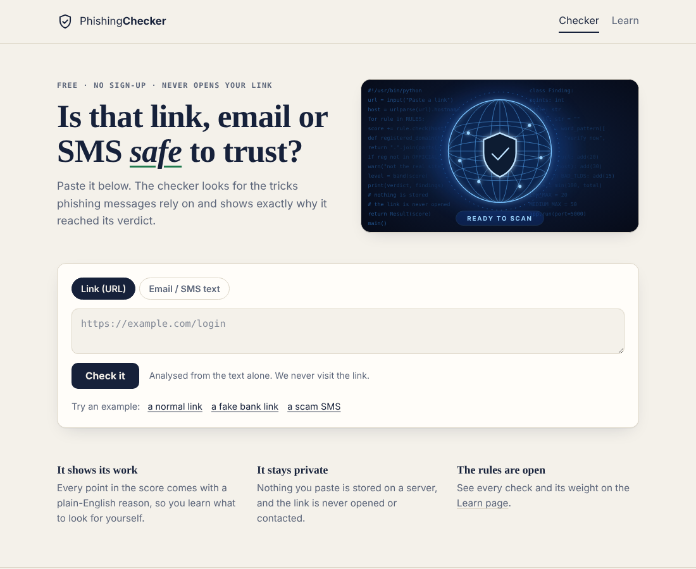
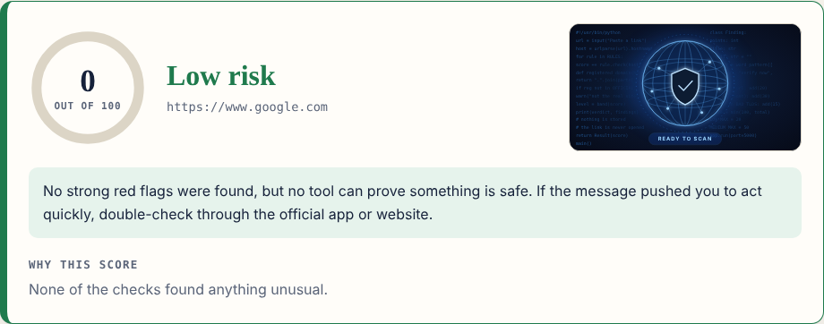
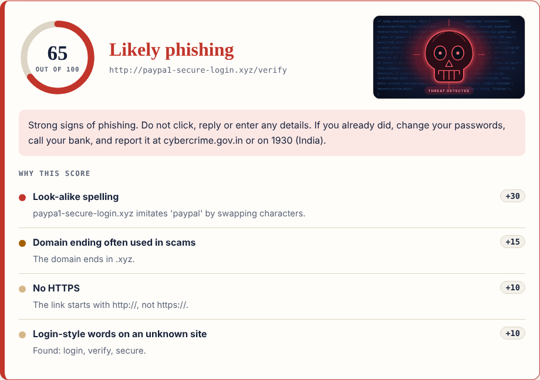

# Phishing Checker

A web app that checks a **link**, **email** or **SMS** for common phishing tricks and explains its verdict in plain English. It gives a 0–100 risk score, a verdict (*Low risk*, *Suspicious*, *Likely phishing*) and a list of the exact reasons behind the score.

> Built by **Shubh Tailor** for the **IBM SkillsBuild × BharatCares National Cybersecurity Bootcamp** (October 2026).



| Safe link | Dangerous link |
|---|---|
|  |  |

## Why this project

Phishing is the most common way people lose money and accounts. Most tools just say "safe" or "unsafe". This one **shows its work**, so users learn what to look for themselves. That makes it useful both as a checker and as a small awareness tool.

## Features

- **Link checker** with 20 rules: IP-address hosts, look-alike spellings (`paypa1`), brand names on the wrong domain, fake subdomains, `@` tricks, punycode and non-ASCII homographs, link shorteners, risky TLDs, fake app downloads, hidden redirects and more.
- **Message checker** for email/SMS/WhatsApp text: urgency, requests for OTP/passwords, threats and fake rewards, generic greetings. Every link in the message is also analysed.
- **Explainable score:** each finding shows its points and a reason. The full rule table is on the in-app *Learn* page.
- **Handles "defanged" links** such as `hxxp://evil[.]com`, as used by security analysts.
- **JSON API** for use from other tools.
- **Private by design:** the link is never opened and nothing is stored on the server.
- **Visual verdicts:** a banner changes with the risk level (ready, look closer, threat detected with a skull).
- Responsive, accessible UI with light and dark mode and keyboard support.

## Tech stack

| Layer | Choice |
|---|---|
| Language | Python 3.10+ |
| Backend | Flask (the detection package uses only the standard library) |
| Frontend | HTML, CSS, vanilla JavaScript (no frameworks, no external requests) |
| Tests | pytest (43 tests) |
| Deploy | gunicorn, Render blueprint included |

## Project structure

```
phishing-checker/
├── app.py                  # Flask app: pages, JSON API, security headers, rate limit
├── checker/                # Detection engine (no web code)
│   ├── rules.py            # Weights, word lists, plain-English explanations
│   ├── url_analyzer.py     # Link analysis
│   ├── email_analyzer.py   # Message analysis
│   └── models.py           # Finding / Result data classes, score bands
├── templates/              # base, index (checker), learn
├── static/                 # css, js, favicon, img (result banners)
├── tests/                  # pytest: detection logic and the web app
├── docs/project-summary.md # Write-up for the bootcamp submission
├── LICENSE                 # MIT
├── requirements.txt
└── render.yaml
```

The detection engine is separate from the web layer, so it can be reused in a CLI, a browser extension or a bot.

## Run it locally

```bash
git clone <your-repo-url>
cd phishing-checker

python -m venv .venv
# Windows:        .venv\Scripts\activate
# Mac / Linux:    source .venv/bin/activate

pip install -r requirements-dev.txt
python app.py
```

Open <http://127.0.0.1:5000>.

Run the tests:

```bash
pytest
```

## API

```bash
curl -X POST http://127.0.0.1:5000/api/analyze \
  -H "Content-Type: application/json" \
  -d '{"type": "url", "content": "http://paypa1-secure-login.xyz/verify"}'
```

`type` is `"url"` or `"email"`. Response (shortened):

```json
{
  "kind": "url",
  "score": 65,
  "level": "high",
  "verdict": "Likely phishing",
  "advice": "Strong signs of phishing. Do not click, reply or enter any details...",
  "findings": [
    {"points": 30, "severity": "high", "title": "Look-alike spelling", "detail": "..."}
  ]
}
```

Errors return `{"error": "..."}` with status 400 (bad input), 413 (too large) or 429 (rate limit).

## How scoring works

Each rule that fires adds points; the total is capped at 100.

| Score | Verdict |
|---|---|
| 0–20 | Low risk |
| 21–50 | Suspicious |
| 51–100 | Likely phishing |

All rules, weights and explanations live in [`checker/rules.py`](checker/rules.py). They are also shown in the app on the *Learn* page.

## Security design

Because this is a security tool, it follows the practices it teaches:

- **Never fetches user-supplied URLs**, which rules out server-side request forgery (SSRF) and avoids touching malicious sites.
- **Strict Content-Security-Policy** (`script-src 'self'`, no inline scripts or styles), plus `X-Frame-Options`, `X-Content-Type-Options`, `Referrer-Policy` and `Permissions-Policy`.
- **XSS-safe rendering:** all results are inserted with `textContent`, never `innerHTML`; Jinja auto-escaping is on.
- **Input validation and limits:** type checks, length caps (2,048 / 5,000 characters) and a 32 KB request limit.
- **Rate limiting:** 30 requests per minute per client (in-memory; use a shared store such as Redis if you run several instances).
- **Privacy:** no server-side storage. The "recent checks" list is kept only in the visitor's own browser and holds a short preview.
- **No external dependencies at runtime in the browser:** no CDNs, fonts or trackers.

## Limitations

- It is **rule-based**. It spots common patterns but cannot prove something is safe, and it does not know about brand-new attacks.
- It never opens the link, so it cannot judge what the page looks like.
- Rules can misfire: a genuine site with login-style words or an unusual address may gain a few points.
- The brand list is small and focused on services common in India (SBI, HDFC, ICICI, Paytm, PhonePe, IRCTC) plus global ones.

## Roadmap

- Look-ups against threat-intelligence sources (e.g. Google Safe Browsing) for a second opinion.
- Domain-age and WHOIS signals.
- A browser extension that reuses the `checker` package.
- Hindi interface.
- Optional machine-learning classifier trained on public phishing datasets, compared against the rule-based baseline.

## Deploy (free option: Render)

1. Push this folder to a GitHub repository.
2. On [render.com](https://render.com), create a **New Web Service** (or **Blueprint**) from the repo.
3. Build command: `pip install -r requirements.txt`. Start command: `gunicorn app:app`.
4. Set the environment variable `TRUST_PROXY=1` so rate limiting sees real client addresses.

`render.yaml` already contains these settings. Render's free tier may sleep when idle, so the first visit can be slow. Check their documentation for current plan details.

## License

MIT. See [LICENSE](LICENSE). Copyright (c) 2026 Shubh Tailor.

## Author

**Shubh Tailor** · [LinkedIn](https://linkedin.com/in/shubhtailor) · [GitHub](https://github.com/shubhtailor419-jpg)
